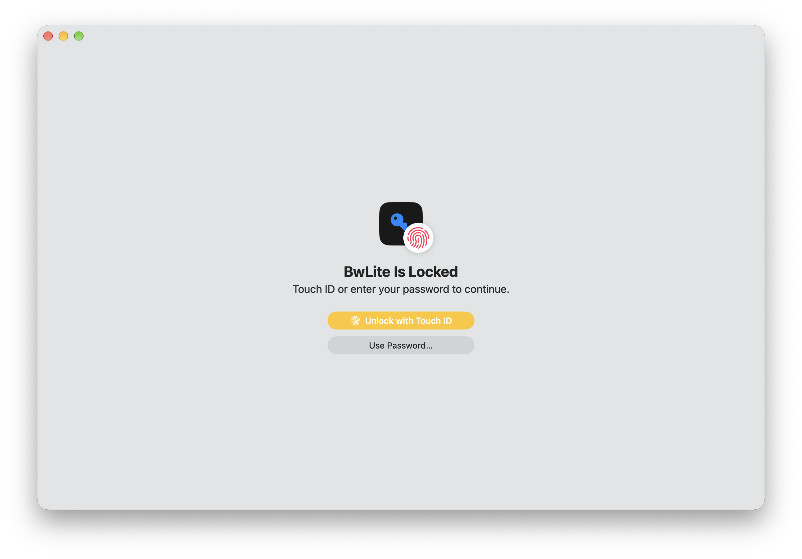
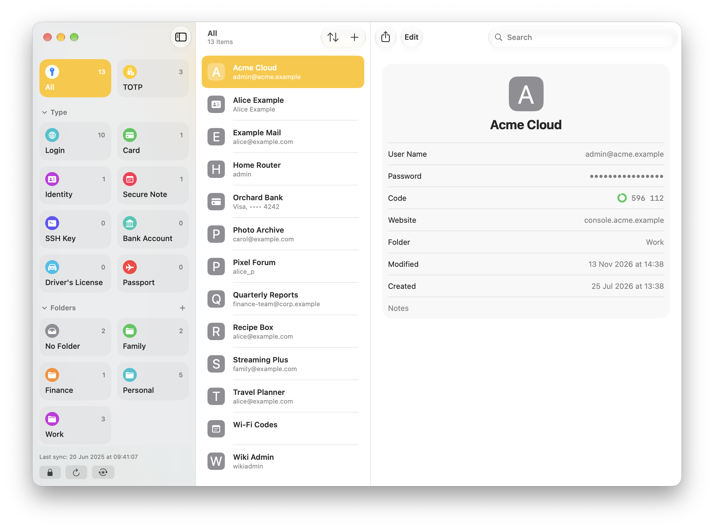
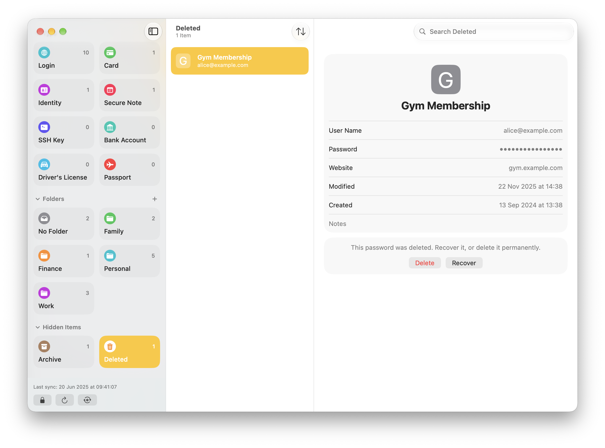
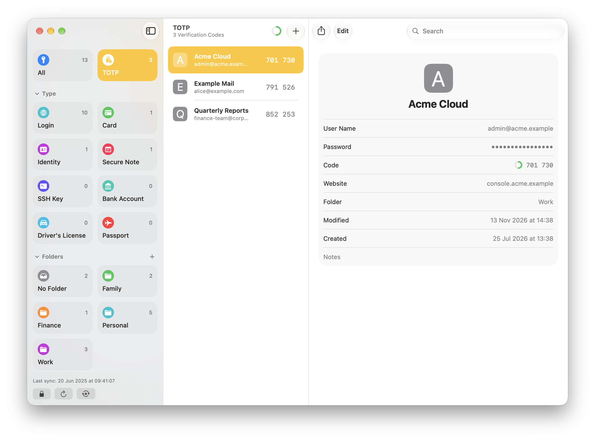

# BwLite

A native macOS client for [Vaultwarden](https://github.com/dani-garcia/vaultwarden) (a Bitwarden-compatible server you
host yourself) that looks and feels like the macOS Passwords app. It is plain SwiftUI, split by component under
[`Sources/BwLite`](Sources/BwLite) (see [Project layout](#project-layout)), and it talks to your server itself.
No other program is needed.

> Unofficial. Not affiliated with or endorsed by Bitwarden, Vaultwarden or Apple.

Written with [Claude](https://claude.ai) (Anthropic's AI assistant). The server side (login, two-step code,
Argon2id and PBKDF2, sync, add, edit, move, delete, recover, folders, organization items, custom fields, attachments, URI match, website icons, and changing the master password and email) was checked against a real Vaultwarden 1.37.5
server. Anything that only exists on a Mac (the interface, the keychain, certificates) has to be tried on a Mac.

## Screenshots









## Features

- Sidebar in sections: All and TOTP (a list of verification codes with a countdown ring), Type (Login, Card, Identity, Secure Note, SSH Key, Bank Account, Driver's License, Passport), Folders, and Hidden Items (Archive, Deleted); search
- Logins, cards, identities, secure notes, SSH keys, bank accounts, driver's licenses and passports can all be shown, copied (secret fields stay as dots until you hover), added (the **+** button asks for the type) and edited. An SSH key needs its fingerprint, public key and private key: Vaultwarden 1.37.5 sends an SSH key without all three as empty
- Custom fields (text, hidden, yes/no) on every kind of item: shown, copied, added, edited and removed. A "linked" field made in another app is shown as "Linked" and kept as it is
- Attachments: files attached to an item are listed under its details; click one to save a copy. In edit mode, **Add Attachment…** picks files (encrypted here, with a key of their own, like the Bitwarden apps do) and the minus button marks one for removal; nothing is sent or removed until you press Save, and Cancel drops the changes. A new item gets attachments after it is saved. A whole file is held in memory while it is encrypted or decrypted, and the server's storage limits apply
- New logins take an authenticator key (TOTP) and a folder when they are made. Every website of a login has its own **URI match** setting (Default, Base Domain, Host, Starts With, Exact, Regular Expression, Never), kept as the other Bitwarden apps keep it; editing a login never loses it. The setting is for the other apps' autofill: BwLite's own Auto-Type searches by text and doesn't use it
- Website icons (Settings > General, on by default): fetched through your Vaultwarden server (`/icons/<host>/icon.png`), which looks them up on the websites, so the server learns which sites you have logins for. They are kept in memory only and dropped when BwLite locks. If the server answers with a redirect (an external icon service is set up), BwLite does not follow it and shows the letter instead
- Settings > Account: change the master password, the email (the server sends a code to the new address) and log out of all devices. Each asks for the current master password, checks it here first, and ends the login on this Mac afterwards, because the server gives the account a new security stamp (every other device has to log in again too)
- Archive: put an item away without deleting it (right-click > Archive / Unarchive); archived items stay out of All
- Show a login; copy its user name, password or website
- Add, edit, move to a folder and delete (to the trash) items; old passwords are kept in the item's history
- Deleted: the trash is listed in its own tile (last in the sidebar); recover an item or delete it for good. Nothing is deleted automatically
- Select several items with ⌘-click (⇧-click for a range, ⌘A for all), then right-click to move, delete, recover or delete them for good together
- Add a folder with the **+** beside Folders in the sidebar; rename or delete one with a right-click on its tile (deleting keeps its items, without a folder)
- Sort by Name, Created, Modified, Username or Website; the default sort is set in Settings
- Generator (the button with the two arrows and an asterisk at the bottom left), with the options and the way of choosing characters of the Bitwarden generator: a **password** (5 to 128 characters; A-Z, a-z, 0-9, `!@#$%^&*`; minimum numbers and minimum special; avoid ambiguous characters), a **passphrase** (3 to 20 words from the EFF long word list, a separator, capitalize, include number) or a **username** (plus addressed email, catch-all email, random word). Nothing is saved in the vault: the options are remembered, the result is not. A password or passphrase is copied as a secret (marked concealed, cleared after 30 seconds). Not included: forwarded email aliases (they need an outside service and its API key) and the generator history. In the new-item sheet and in the edit screen of a login, the same icon next to the password (and an eye to show or hide it) opens the generator with the Password and Passphrase tabs and a **Use this password** button; a new login still starts with a simple generated password (20 letters and digits)
- Auto-lock: a switch and a number of minutes in Settings; BwLite locks itself after that long unused (on, 15 minutes at first)
- Touch ID (optional, off by default): after one unlock with the master password, clicking the fingerprint on the lock screen unlocks it again. The vault key is then kept in your login keychain, which is less safe than typing the password each time; the master password is still needed to log in
- Offline use: unlocking, listing, showing and copying only read the local, encrypted copy of the vault kept
  on this Mac. Only Sync and saving a change need the network, so log in and sync at least once while online
- Auto-Type: press <kbd>⌃⌥A</kbd> in any app, pick a login, and BwLite types the user name, Tab, the password
  and Return for you. It needs the Accessibility permission, asked for the first time
- Works with a private CA or a self-signed certificate (see below)

## Requirements

- Apple Silicon Mac, macOS 13.5 or later (the release build is arm64 only)
- A Vaultwarden server, with an account that uses a master password

Not supported: the official Bitwarden cloud, accounts with the newer "V2" encryption, single sign-on accounts, and
two-step methods other than an authenticator app.

## Install

1. Download `BwLite-<version>-arm64.zip` from [Releases](../../releases) and unzip it.
2. Move `BwLite.app` to Applications.
3. The app is not notarized. On first launch open **System Settings > Privacy & Security** and click
   **Open Anyway**, or run:

   ```sh
   xattr -dr com.apple.quarantine /Applications/BwLite.app
   ```

4. Open Settings (<kbd>⌘,</kbd>), set the server (for example `https://vault.example.com`; macOS blocks plain `http://`
   addresses), then log in on the first screen with your email, master password and, if the account has one, an
   authenticator code.

Coming from a version that used `bw`: log in again. The old local copy is not reused.

## How it works

BwLite sends the same requests the Bitwarden apps send (`/identity/accounts/prelogin`, `/identity/connect/token`,
`/api/sync`, `/api/ciphers`) and does the encryption itself: your master password becomes a key with PBKDF2-SHA256 or
Argon2id, and every field is AES-256-CBC with an HMAC-SHA256 tag. The server only ever sees encrypted data.

On this Mac BwLite keeps, in `~/Library/Application Support/BwLite/`:

- `vw-vault.json`: the server's encrypted copy of your vault, as it came
- `vw-account.json`: the server address, your email, the encrypted account key and an encrypted refresh token

Neither can be read without your master password. The decrypted vault, the account key and the access token live in
memory only, from unlocking until locking. **Settings > Account > Log Out** deletes both files.

### Logging out and the server

Log Out removes the account and the vault copy from this Mac and drops the tokens held in memory. It cannot end this
Mac's login **on the server**: Vaultwarden 1.37.5 has no request that revokes one device's session (checked in its
source; the refresh token is not rotated and there is no revoke or logout endpoint). The one thing that invalidates
logins is a new security stamp, which ends every device's login at once: **Settings > Account > Log Out of All
Devices**. Until then, a copy of this Mac's refresh token (it is only on disk encrypted with your account key) would
still work.

### Memory

When BwLite locks or you log out:

- the account key and the organization keys are overwritten with zeros (`memset_s`), and so are the keys made while
  working: the temporary bytes of your master password, the master key, an item key, and the decrypted bytes of a field
  once the text has been made from them. Keys are read in place by the encryption, not copied around
- the decrypted vault, the tokens and the website icons are let go
- the clipboard is emptied if it still holds a password or code that BwLite copied (anything you copied yourself
  afterwards stays)

What this cannot do: Swift text (a decrypted password or note, the master password you typed, a token) cannot be
overwritten reliably, so after it is let go it stays in freed memory until something else uses the space. Copies made
by system frameworks (CryptoKit's key objects, the keychain, text fields) are out of reach too. So this shortens how
long the keys exist in memory; it is no protection against someone who can read BwLite's memory while it is unlocked,
or a memory dump taken right after locking.

### Self-signed or private CA certificates

BwLite uses the macOS keychain like Safari does:

- **Keychain (default):** in Keychain Access, open your server's certificate (or your CA) and set Trust to
  **Always Trust**.
- **Certificate file:** Settings > Server Certificate > Choose… (PEM or DER). It is trusted in addition to the usual
  ones.

## Project layout

```
Sources/BwLite/
├── App/          BwLiteApp (the @main entry), ContentView (login, lock or vault), AppCommands (menu bar)
├── Model/        What a vault item is: Entry, ItemKind, Website, Attachment, CustomField, Totp, Folder
├── Crypto/       The encryption: VWCrypto (master key, EncString, RSA), Argon2id, Blake2b, SecureMemory,
│                 and ApplePrimitives (the one file that needs CommonCrypto and Security)
├── Core/         The Vaultwarden client: VWCore (login, unlock, sync, every change to the vault), AccountStore,
│                 VW (settings), WebsiteIcons, Errors, SessionDelegate
├── Generator/    VWGenerator (password, passphrase, username) and VWWordList (the EFF list)
├── Services/     AutoLock, Clipboard, PopUpMenu, TouchID, and AutoType/ (the ⌃⌥A shortcut, panel and keystrokes)
├── State/        Vault: the state the interface observes, and the actions it calls
└── Views/        One folder per screen: Lock, Settings, Detail, Generator, NewItem, Editing, Vault, and
                  Components (colours, rows, cards and other pieces shared by several screens)
```

Every file starts with a comment saying what it holds. The lower folders know nothing of the upper ones: `Model`,
`Crypto`, `Core`, `Generator` and `Services/AutoLock.swift` import no UI framework and use nothing from `App`, `State`,
`Views` or the rest of `Services`, so they build and are tested without a Mac (see Tests).
`VaultView`, the main screen, is the largest type: `Views/Vault/VaultView.swift` holds its state and body, and the
`VaultView+*.swift` files next to it hold the sidebar, the item list, sorting, selection, editing, the right-click
menus and the detail column.

### Tests

`vwcore/` holds the tests of everything that does not need a Mac: the encryption (against Python reference values), the
generators, and the whole Vaultwarden client against a real Vaultwarden 1.37.5 server (login with PBKDF2 and Argon2id,
two-step code, sync, every kind of change, organization items, attachments, website icons, account changes).
`make_harness.py` compiles the real files of `Model`, `Crypto`, `Core` and `Generator` on Linux, with
`shim_linux.swift` standing in for `Crypto/ApplePrimitives.swift`, and adds the test driver. `seed_server.py` and
`make_accounts.py` prepare the accounts on an empty test server. The scripts use the paths of the Linux sandbox they
were written in (`/opt/q/work`, `/home/claude`): change them to yours. Nothing under `Views`, `State`, `App` or
`Services` (except `AutoLock`) is covered by these tests.

## Build

### With GitHub Actions (releases)

The workflow (`.github/workflows/release-bwlite.yml`) needs the `Sources/BwLite` folder and `AppIcon.icns`
in the repository root. It compiles every `.swift` file under `Sources/BwLite` into one program, packs `BwLite.app`,
signs it ad hoc and zips it.

- **Release:** Releases > Draft a new release > new tag (for example `v1.0.0`) > Publish. The zip and its
  `.sha256` are attached to that release.
- **Test build:** Actions > Release BwLite > Run workflow. The zip is kept as a workflow artifact and nothing is
  attached to a release.

A release builds the commit its tag points at. After changing anything under `Sources/BwLite`, publish a release with a
**new** tag, or use Run workflow on `main`.

### With Xcode

1. Create a macOS **App** project (SwiftUI), delete the Swift files Xcode generated (its `BwLiteApp.swift` and
   `ContentView.swift` have the same names as BwLite's own), and drag the `Sources/BwLite` folder into the project
   (Create groups, target BwLite).
2. Turn **App Sandbox** off: target > Signing & Capabilities, and Build Settings > Enable App Sandbox = No.
3. Add `AppIcon.icns` to the target's **Copy Bundle Resources** and set `CFBundleIconFile` to `AppIcon` in the
   target's Info tab.
4. Set the deployment target to macOS 13.5 or later.

The sources are written for Xcode 26, where every declaration is `@MainActor` by default.
To build without Xcode, from the repository root:

```sh
swiftc -parse-as-library -O -wmo -module-name BwLite $(find Sources/BwLite -name '*.swift') -o BwLite
```

(add `-default-isolation MainActor` to match Xcode 26; the workflow does that and retries without it if the compiler
does not know the option).
Argon2id runs in plain Swift, so unlocking an Argon2id account is much slower in a Debug build than in a Release build.

## Credits

- [Vaultwarden](https://github.com/dani-garcia/vaultwarden) by Daniel García and contributors, whose server code
  defines the requests BwLite sends.
- The [EFF long word list](https://www.eff.org/dice) for passphrases and random-word usernames, © Electronic Frontier
  Foundation, licensed [CC BY 3.0 US](https://creativecommons.org/licenses/by/3.0/us/).
